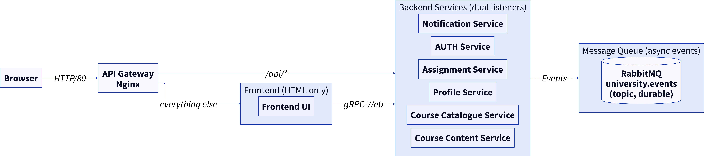

# Osborne.AI - Microservices Project

Osborne.AI is a Student Services Dashboard for a university. It uses a microservices architecture and is the INFS605 (Microservices) course project.

GitHub: https://github.com/bundgaard1/osbourne.ai

## Setup steps

Prerequisites:

- Go 1.26+
- Docker and Docker Compose
- `buf`, `templ`, `protoc-gen-go`, `protoc-gen-go-grpc` (all Go tools, `make tools` installs them)

Run these commands:

```bash
make generate   # Generates protobufs/gRPC stubs and the frontend templ code
docker compose up --build   # Builds and starts all services in containers
```

- Dashboard: **http://localhost:8080**. The API Gateway (Nginx) is the only host-exposed application port.
- RabbitMQ management console: **http://localhost:15672** (`guest` / `guest`).

No service publishes a host port. The frontend is not exposed on purpose. It serves HTML only, and a reachable copy would serve pages that cannot call `/api/*`.

### Demo accounts

The services seed two accounts on first start. The login page shows the same details.

| Role    | Email                    | Password     | Name             |
| ------- | ------------------------ | ------------ | ---------------- |
| Student | `student@osbourne.local` | `student123` | Andy Osborne     |
| Teacher | `teacher@osbourne.local` | `teacher123` | Dr. Jane Teacher |

Account creation is not available. These seeds are the only accounts.

## Evidence

- **[docs/evidence.md](docs/evidence.md)** - consolidated evidence with descriptions of all diagrams and screenshots (Docker stack, UI, RabbitMQ/async flow, request ID correlation, error responses, and persistence across restart).
- **[docs/screenshots/](docs/screenshots/)** - raw screenshot files and the capture plan ([README.md](docs/screenshots/README.md)).
- **[docs/api-examples.md](docs/api-examples.md)** - real `curl` request and response pairs from a running stack, including the failures.

## Tech stack

- **Go** for all services.
- **Go + Templ + `chi`** for the server-rendered frontend.
- **Nginx** for the API Gateway. It routes `/api/*` to the owning service and the rest to the frontend, and adds `X-Request-ID`.
- A **dual listener** in every backend: gRPC for internal calls, and a **grpc-gateway** REST listener in front of the same server for browser calls.
- **gRPC** for synchronous inter-service calls.
- **RabbitMQ** for asynchronous events, on the durable `university.events` topic exchange.
- **Per-service databases**: embedded **SQLite** (GORM) for most, **CloverDB** (document store) for course-content. No shared database.

## Architecture



- **Authentication Service** (`auth-service`): credentials, JWT issue and validation, and the `account.created` event. Owns the session boundary.
- **Student Profile Service** (`profile-service`): student and staff profile data, built from `account.created`.
- **Course Catalogue Service** (`course-catalogue-service`): courses, catalogue, and enrolment. Publishes `course.enrolled`.
- **Course Content Service** (`course-content-service`): course content and modules (CloverDB).
- **Assignment / Grading Service** (`assignment-service`): assignments, submissions (upload and download), and grading. Publishes `grade.published`.
- **Notification Service** (`notification-service`): the notification inbox. Consumes `account.created`, `course.enrolled`, and `grade.published`.
- **Frontend UI** (`frontend`): the server-rendered dashboard. Reads from all services over gRPC.

The frontend reads page data over gRPC. Browser `/api/*` calls go through the gateway to the owning service's REST listener. Shared code (logging, JWT parsing, gRPC interceptors, the gateway listener, request-ID correlation) is in the `common` module. See [docs/design.md](docs/design.md) for the request flow.

## API endpoints

Every browser call goes to the gateway at `http://localhost:8080` and is served by the owning service's REST listener. The surface has **25 endpoints**: 23 from the protobuf `google.api.http` annotations, plus two hand-written streaming routes. Authenticated routes need the session cookie or an explicit `Authorization: Bearer` header. The full table (with the RPC each route maps to) lives in [docs/design.md](docs/design.md#service-endpoints); every failure uses one JSON shape, shown in [docs/api-examples.md](docs/api-examples.md).

## Testing

```bash
make test          # go test + go vet in every go.work module
make routing-test  # /api/* routing table against stub upstreams (requires docker)
```

For the manual end-to-end pass (stack up, UI, documented `curl` calls), see [docs/screenshots/README.md](docs/screenshots/README.md). The captured results are the evidence in [docs/api-examples.md](docs/api-examples.md) and [docs/screenshots/](docs/screenshots/).

## Known limitations

- **No TLS/mTLS, no rate limiting, no health checks.** Internal gRPC uses `insecure` credentials. No service exposes `/healthz` or a Docker `HEALTHCHECK` (only RabbitMQ has one), and the gateway has no rate limit. Acceptable on the private Compose network, not production-ready.
- **RabbitMQ uses the stock `guest:guest` credentials**, and the management dashboard is at `localhost:15672`. Docker Compose does not interpolate `.env` into the service `environment:` blocks, so these are not configurable from `.env`. But the `.env.exmample`shows the values needed for a service.
- **The notification consumer is not idempotent.** RabbitMQ delivery is at-least-once, so a redelivered event can create a duplicate notification.

## Docs

- [Evidence](docs/evidence.md) - descriptions of all diagrams and screenshots (including error cases and persistence).
- [Design document](docs/design.md) - architecture, isolation, service endpoints, event catalog, and request correlation.
