# Evidence

This document describes all the images found in the repository as evidence for the system. Each image is described as it appears in the actual screenshots/diagrams (without reproducing the images here).

The evidence is organized into diagrams and screenshots, matching the repo structure: [diagrams/](diagrams/) and [screenshots/](screenshots/). For the capture plan and checklist, see [screenshots/README.md](screenshots/README.md). For API request/response transcripts, see [api-examples.md](api-examples.md).

## Whole stack up

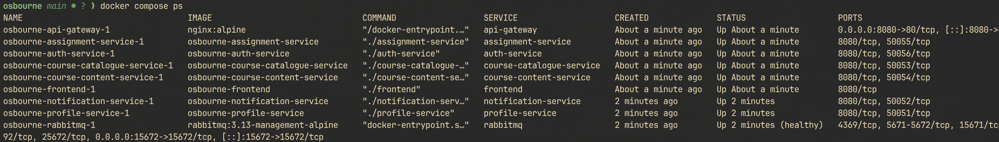
`docker compose ps` output showing the whole stack up:
- All containers running (Up): nginx, frontend, auth-service, profile-service, course-catalogue-service, course-content-service, assignment-service, notification-service, rabbitmq.
- Only nginx (port 80) and rabbitmq (ports 5672, 15672) published to host; other services have no host-exposed ports (internal network only).
- Matches the documented architecture where nginx is the sole public entry.

## Login request

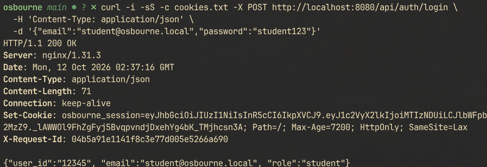
Login page showing seeded credentials presented to the user:
- Login UI for Osborne.AI (Student Services Dashboard).
- Shows demo accounts: Student (student@osbourne.local / student123) and Teacher (teacher@osbourne.local / teacher123). Account creation not available.

## Login to fresh account dashboard

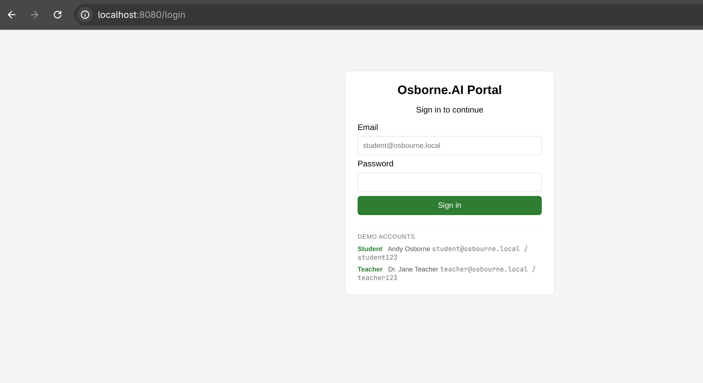
Login page (UI state) as part of login flow; displays the login form with seeded student credentials visible as reference.

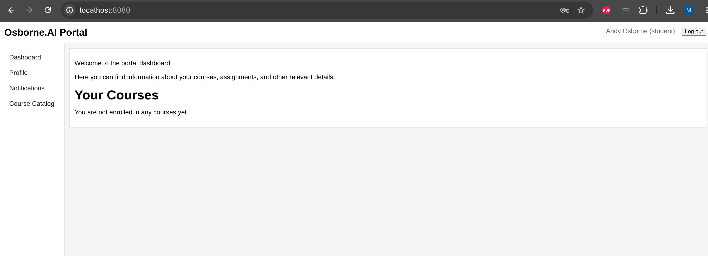
Dashboard view after signing in as student@osbourne.local:
- User context shown (logged in as student). 
- Dashboard content populated from backend over gRPC (profile data, enrolments/listings rendered server-side via Go+Templ). Demonstrates frontend → backend gRPC path functioning.

## Enrollment flow

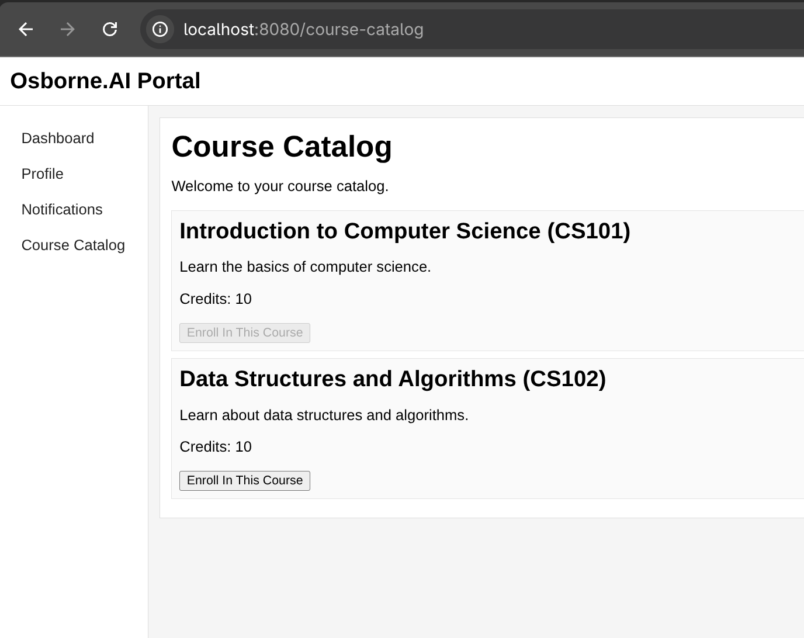
Enrollment action captured from the UI:
- Student enrolling in a course from the catalogue. 
- Shows enrollment interaction/page state; this action triggers `course.enrolled` event published by course-catalogue-service.

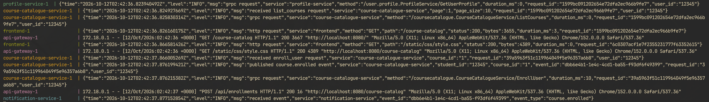
System logs captured around enrollment time (publisher/consumer logs):
- Shows course-catalogue-service publishing `course.enrolled` and notification-service consuming it (same event correlation). 
- Provides end-to-end trace of the asynchronous flow across services (event ID/event type visible in logs).

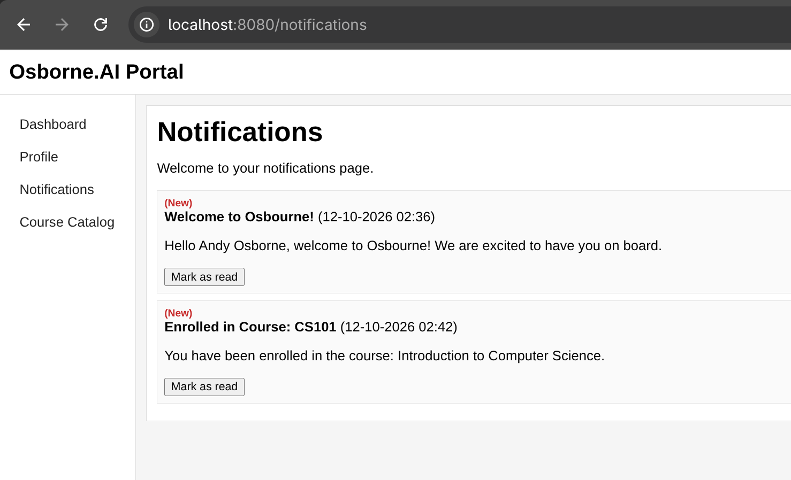
Notification inbox view at `/notifications`:
- Shows new notification `Enrolled in Course: ...` created as a result of the enrollment. 
- Demonstrates asynchronous consequence: notification exists because notification-service consumed the `course.enrolled` event (caller never directly touched notification service).

## Request ID correlation

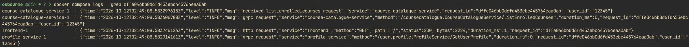
Request ID correlation trace:
- Browser/network context showing `X-Request-Id` value from a response.
- Terminal/log output showing the same request ID appearing in logs across nginx/frontend/backend services. 
- Proves end-to-end request correlation as described in design.

## Bad request handling

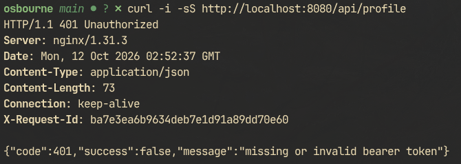
Error handling - no token (auth interceptor):
- `curl` request to `http://localhost/api/profile` without authentication.
- Response shows HTTP 401 with shared JSON error shape: `{"code":401,"success":false,"message":"missing or invalid bearer token"}`. 
- Proves unauthenticated requests are rejected with JSON (not HTML).

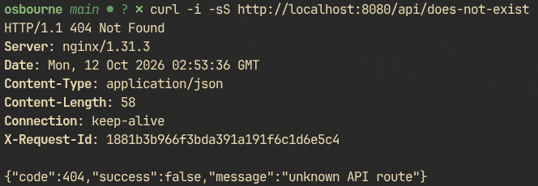
Error handling - unknown /api/ path (gateway catch-all):
- `curl` to `http://localhost/api/does-not-exist`.
- Response shows HTTP 404 with shared JSON error shape: `{"code":404,"success":false,"message":"unknown API route"}`. 
- Proves unrouted API paths return JSON from gateway (not frontend HTML).

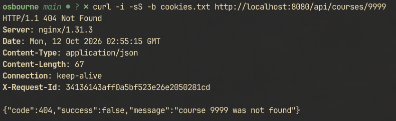
Error handling - missing resource (service 404):
- `curl` to `http://localhost/api/courses/9999` with valid session cookie.
- Response shows HTTP 404 with shared JSON error shape: `{"code":404,"success":false,"message":"course not found"}`. 
- Demonstrates correct service-layer 404 for missing resource (the regression fix).

## Role-based UI

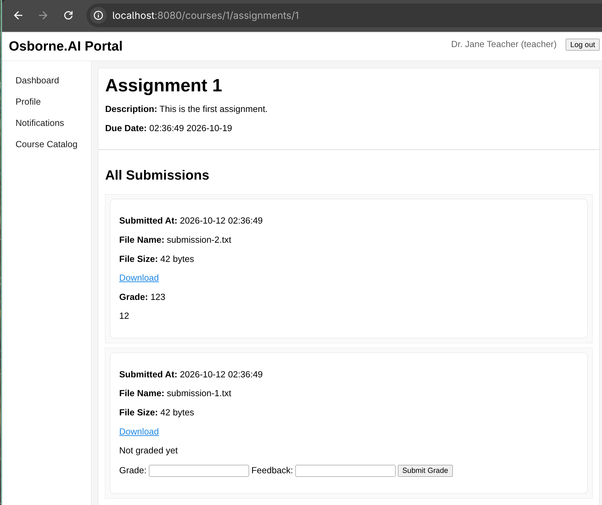
Teacher view (role: teacher):
- Logged in as Dr. Jane Teacher (teacher@osbourne.local). 
- Shows assignments UI with teacher-facing controls/actions for managing assignments.
- Demonstrates role-based rendering/permissions in the frontend based on authenticated user role.

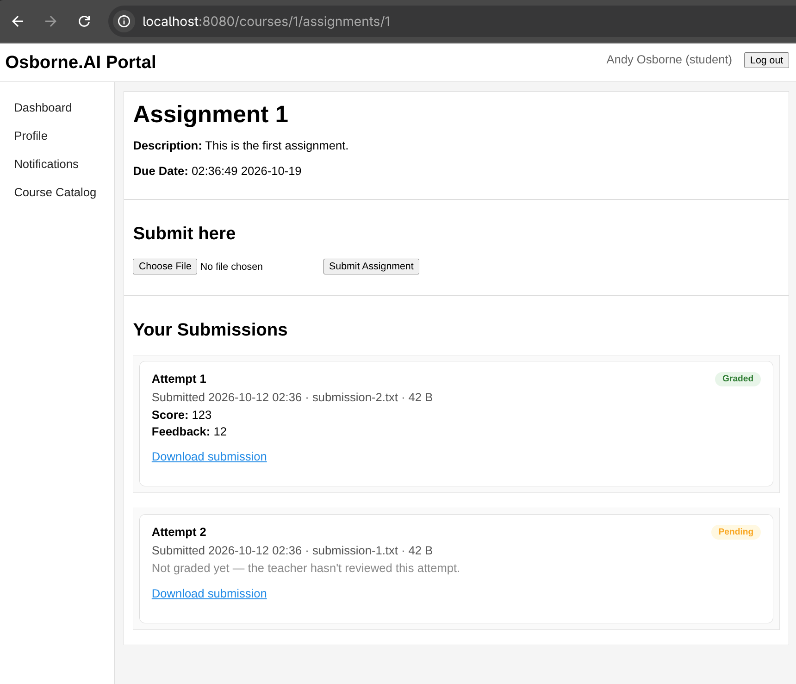
Student view (role: student):
- Logged in as Andy Osborne (student@osbourne.local).
- Shows assignment view from student perspective (no teacher management controls).
- Demonstrates role-based UI differences between student and teacher roles.

## Persistence across restart

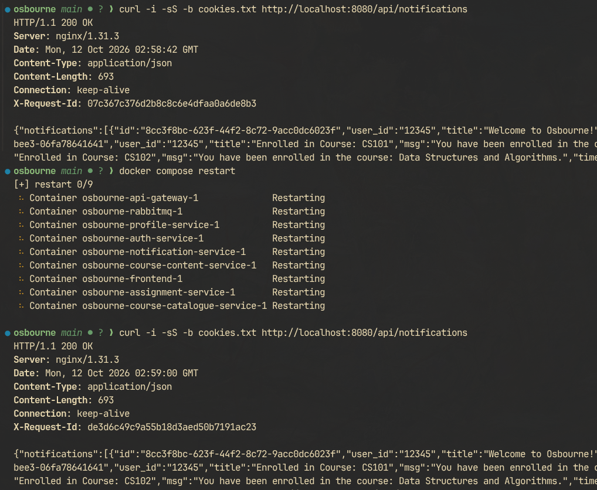
Persistence - after restart:
- Shows the same data (same notification ids/rows) still present after restart. 
- Demonstrates persistence via named volumes (not in-container state).

Note: The screenshots/README.md checklist also lists 01-compose-ps.png as the intended filename for the full stack; the actual file present is 01-whole-stack.png. Both represent the same evidence (docker compose ps). 
